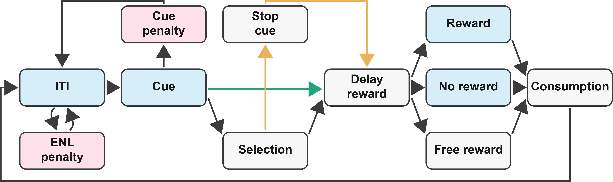
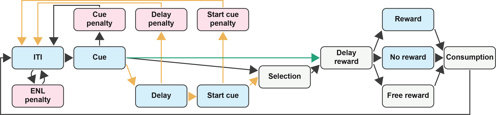
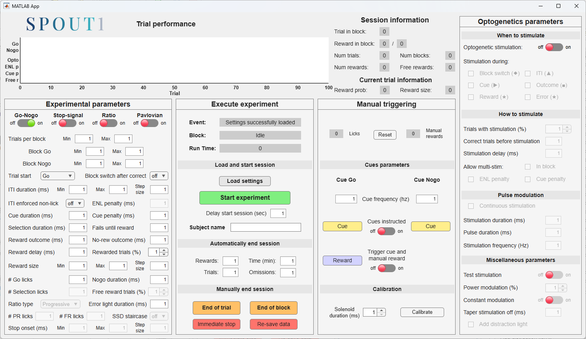
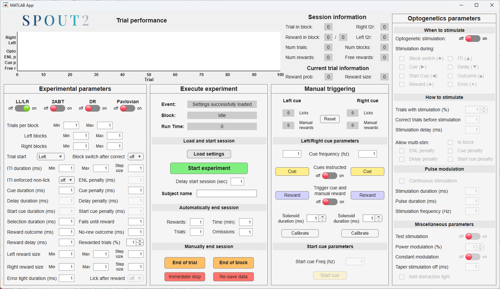

# SPOUT · software

Control software for **SPOUT**, part of the [spout-task](https://github.com/spout-task) project. It is split
into `SPOUT1/` (one spout) and `SPOUT2/` (two spouts); each contains its Teensy firmware
and its MATLAB GUI.

```
SPOUT1/  teensy_firmware/teensy1spout/ (teensy1spout.ino)   matlab_GUI/ (SPOUT1.mlapp + AppArduinoConnection.m)
SPOUT2/  teensy_firmware/teensy2spout/ (teensy2spout.ino)   matlab_GUI/ (SPOUT2.mlapp + AppArduinoConnection.m)
```

## Firmware
The Teensy 4.1 runs the full task state machine; the MATLAB GUI only sends settings and reads the data
the Teensy reports. Open the `.ino` in the Arduino IDE with **Teensyduino** and upload it to the Teensy.
The Teensy EEPROM keeps the last settings across sessions, even when the power is off.
SPOUT needs a **Teensy 4.1**: pins 40 and 41 do not exist on the Teensy 4.0.

## Task modes
**SPOUT1:** go/no-go, stop-signal, fixed-ratio, progressive-ratio, Pavlovian conditioning

**SPOUT2:** uninstructed LL/LR, instructed LL/LR, two-armed bandit (2ABT), delayed-response (DR), Pavlovian conditioning

Predefined settings for each task live in the separate [settings](https://github.com/spout-task/settings) repository.

### State machines

<p align="center">
  
</p>
<p align="center"><em>SPOUT1 state machine (one spout). Boxes are task states, arrows are the transitions between them.</em></p>

<p align="center">
  
</p>
<p align="center"><em>SPOUT2 state machine (two spouts), with the extra delay and start cue states and their penalties.</em></p>

## MATLAB graphical user interfaces
`SPOUTn.mlapp` (MATLAB App Designer) connects to the Teensy, loads a task settings file,
sets parameters, runs the session, and reports performance live. `AppArduinoConnection.m`
handles the serial link.

### SPOUT1 and SPOUT2 GUIs

<p align="center">
  
</p>
<p align="center"><em>SPOUT1 graphical user interface (two spouts). GUI allows to choose different tasks and change task variables.</em></p>

<p align="center">
  
</p>
<p align="center"><em>SPOUT2 graphical user interface (two spouts). GUI allows to include closed-loop optogenetics stimulation.</em></p>

## Requirements
- **Teensy 4.1** on the [Teensy breakout board](https://github.com/spout-task/hardware/tree/main/teensy_breakout_board).
- **Windows** computer: the GUI finds the Teensy through the Windows registry.
- **MATLAB** (tested on R2021b through R2026a).
- **Arduino IDE** ([download](https://www.arduino.cc/en/software/)) with **Teensyduino** ([download](https://www.pjrc.com/teensy/td_download.html)) for flashing the firmware.

The pin map of both firmwares is in the [Teensy breakout board README](https://github.com/spout-task/hardware/tree/main/teensy_breakout_board).

## Related repositories
[hardware](https://github.com/spout-task/hardware), [analyses](https://github.com/spout-task/analyses), [settings](https://github.com/spout-task/settings), [example_data](https://github.com/spout-task/example_data)

## License
**GPL-3.0-or-later** ([`LICENSE`](LICENSE)). See also [`CITATION.cff`](CITATION.cff).
